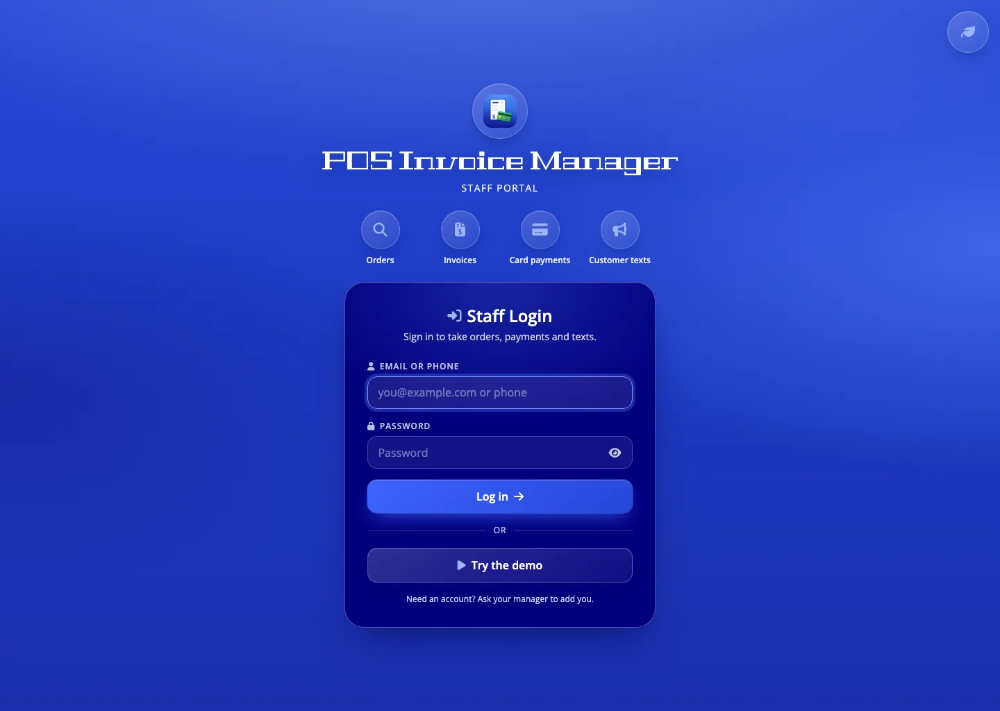
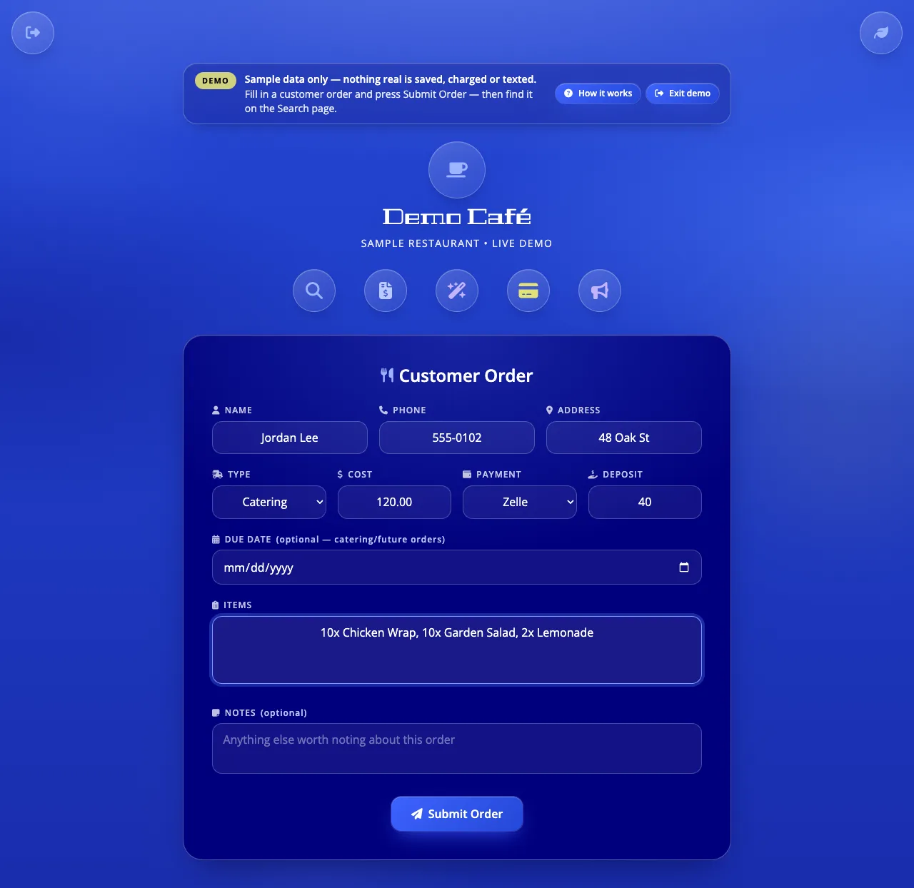
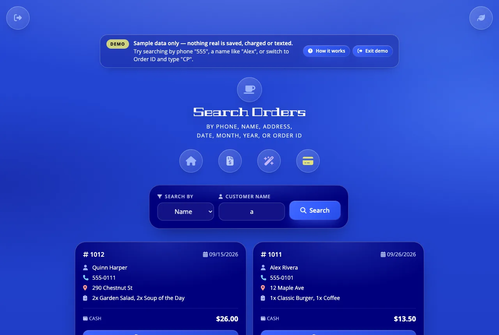
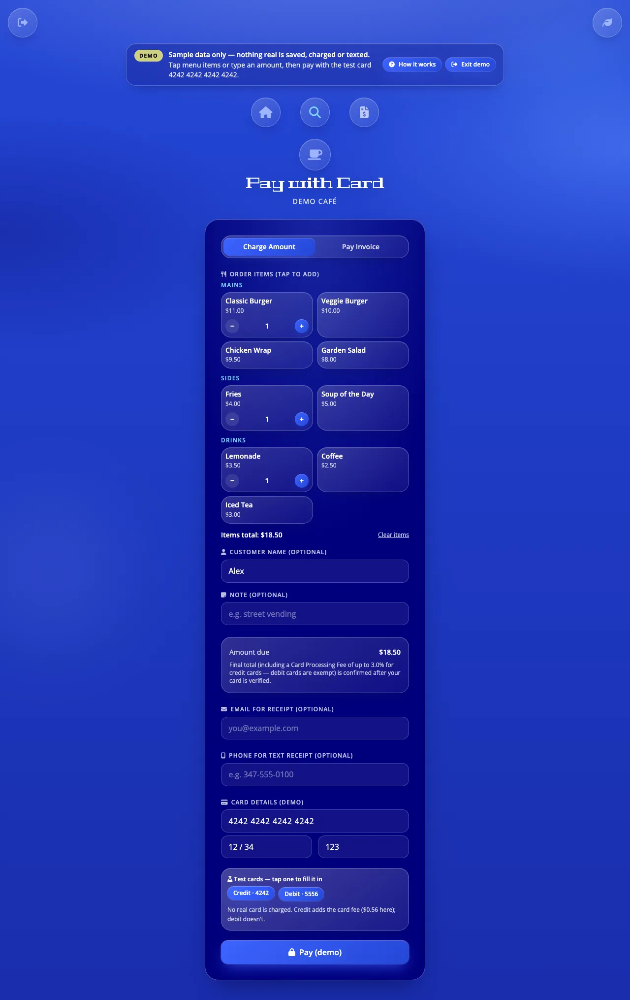
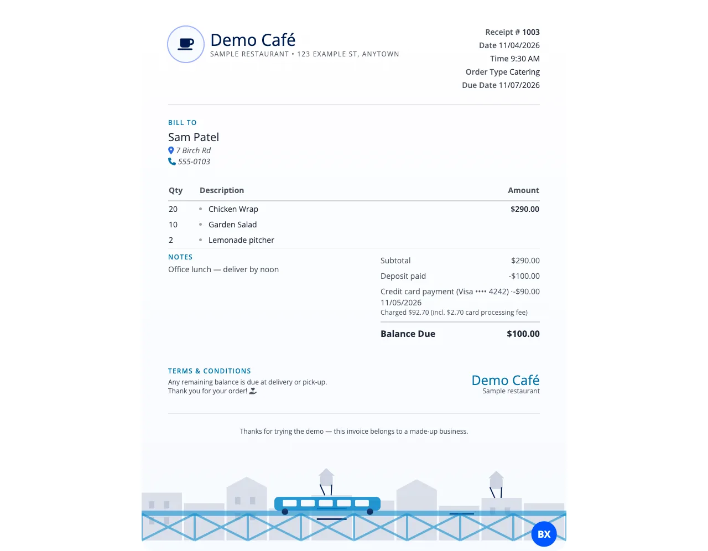
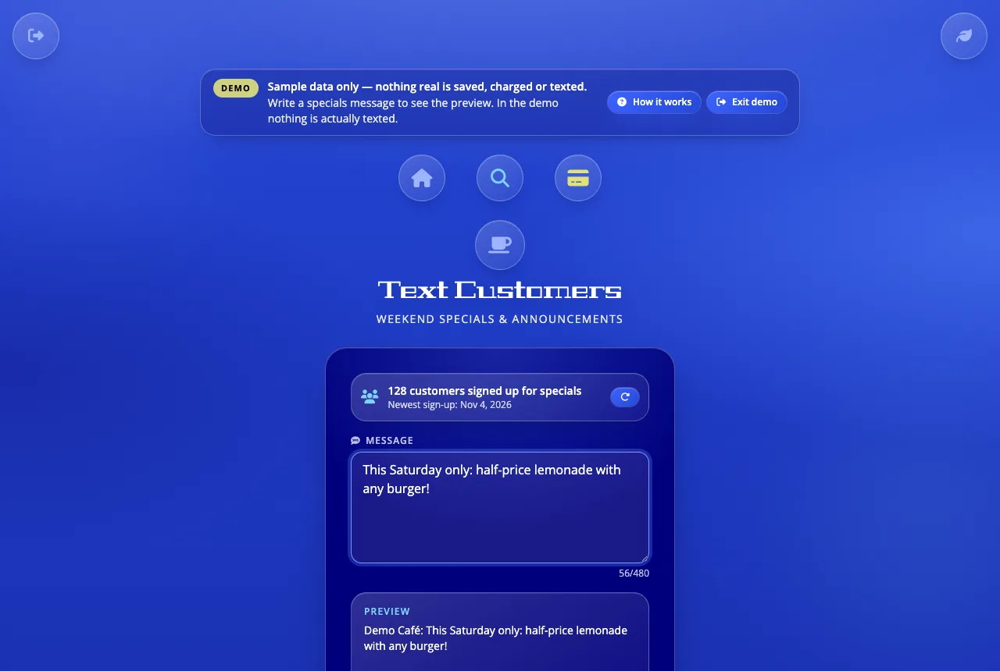
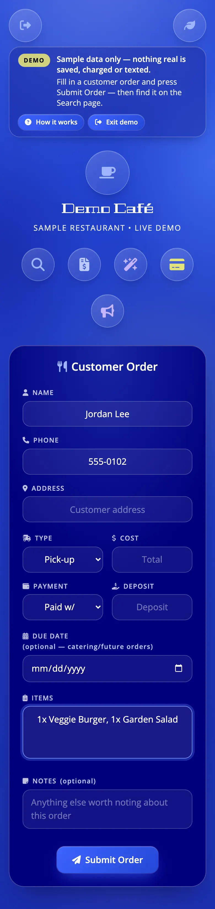
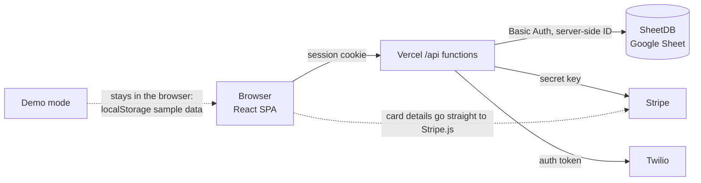

# POS Invoice Manager

[](https://github.com/WebDesign-MultiMedia/POS-Invoice-Manager/actions/workflows/ci.yml)

A point-of-sale and invoicing app built for a real Bronx catering business: orders, printable invoices, card payments and customer texts, used by staff every day.

**Live:** https://pos-invoice-manager.vercel.app

**Try it without an account:** open the link and press **Demo** on the login screen. Demo mode runs entirely in your browser on a made-up café's data. Take an order, search it, print its invoice, "charge" a test card (`4242 4242 4242 4242`) and preview a text broadcast. Nothing is saved, charged or texted, and the real orders are never touched.



| Order form | Search | Card payment |
|---|---|---|
|  |  |  |
| **Printable invoice** | **Text broadcast** | **On a phone** |
|  |  |  |

## Features

- **Orders:** an order form for delivery, pick-up and catering, with deposits, due dates and notes. A half-typed order survives a reload or an expired login.
- **Search:** find orders by phone, name, address, date, month or year, and card payments by Order ID.
- **Invoices:** printable one-page invoices that subtract deposits and earlier card payments from the balance. Save as an image, or share a signed read-only link with the customer.
- **Card payments:** Stripe PaymentIntents for walk-up sales (tap-to-add menu) or an invoice balance. A compliant card fee (≤ 3%, credit only, never debit) is calculated on the server. Receipts can be texted.
- **SMS broadcast:** staff text specials to customers who opted in on the restaurant's website, with STOP handling. The page shows the live subscriber count and newest sign-up.
- **Staff login:** the whole app and every API route sit behind a staff session.
- **Demo mode:** the full app on sample data with no server access, for visitors.
- **Six themes, mobile-first:** tested at 390, 768 and 1280 px. 16 px inputs (no iOS zoom), visible focus rings, and WCAG 2.1 AA text contrast in every theme.

## Tech stack

React 18 · Vite · React Router · Tailwind CSS · Vercel serverless functions (Node) · Stripe (PaymentIntents + Elements) · SheetDB (Google Sheets as the database) · Twilio (A2P 10DLC messaging) · scrypt password hashing + HMAC-signed cookies · Vitest · ESLint · GitHub Actions

## Architecture



- The browser only ever calls the app's own `/api/*` routes. The SheetDB ID, Stripe secret key and Twilio credentials exist only as Vercel environment variables.
- `/api/sheets` isn't a generic proxy. It accepts a short list of named actions (`orders`, `order`, `createOrder`, …), so the browser can't choose SheetDB paths or methods, and updates and deletes aren't exposed.
- **Demo mode stays browser-only.** `src/api/sheetdb.js` routes every call to `src/lib/demo.js` when demo is on. The data is fictional, lives in `localStorage`, and is wiped when you leave. Demo grants no server access: every `/api` route still requires a real staff session. A unit test asserts that demo mode never calls `fetch`.

## Security

- **Staff login:** passwords are hashed with scrypt and checked in constant time (unknown logins take as long as known ones). Sessions are HMAC-signed, HttpOnly, SameSite=Lax, Secure cookies that last 7 days. Removing a staff account ends their session immediately. Failed logins are rate-limited per IP.
- **Secrets stay server-side:** the only `VITE_` (browser) variable is the Stripe *publishable* key. CI scans the built bundle and fails if a SheetDB URL, Stripe secret, Twilio SID, Google Sheet link or server env var name ever appears in it.
- **Signed share links:** a customer's invoice link carries an HMAC token for that one invoice. It can't be changed to open another invoice, and the response is trimmed to what the invoice shows.
- **Server-side payment amounts:** the server re-reads the card's funding type from Stripe and computes the surcharge and total itself, so client-sent totals or "debit" claims are ignored. It also caps a single charge as a sanity check. Card declines show Stripe's cardholder message; other errors stay in server logs.
- **Opted-in SMS only:** recipients come only from website sign-ups signed by the consent form's server. Rows typed into the sheet by hand are rejected. STOP replies are blocked by Twilio, and anyone marked *Unsubscribed* in the sheet is skipped. Every text names the business and says "Reply STOP to unsubscribe." Sending needs a staff login, and the page confirms the recipient count before anything goes out.
- **Security headers** (in `vercel.json`): a strict Content-Security-Policy, `X-Frame-Options: DENY`, `X-Content-Type-Options: nosniff`, `Referrer-Policy` and `Permissions-Policy`.
- **CI:** lint, tests, a build with placeholder keys only, the bundle secret scan, and `npm audit --audit-level=high` run on every push and pull request. Deploys happen on Vercel, not in CI, so CI never holds a secret.

## Testing

```bash
npm test            # run once (Vitest)
npm run test:watch  # re-run on save
npm run lint        # ESLint (React + hooks rules)
```

There are 134 tests, and all network calls (Stripe, Twilio, SheetDB, `fetch`) are mocked. They cover:

- **Surcharge math:** the 3% cap, the pass-through fee, rounding to cents, $0 and large amounts, and that the amount shown equals the amount sent to Stripe.
- **Formatting and totals:** currency, dates and times, item parsing, menu prices, cart totals, and invoice balances with deposits and card payments.
- **Auth:** password hashing and checks, session cookies (valid, tampered, wrong secret, expired, removed account), share tokens (valid, tampered, wrong invoice), and phone and email login formats.
- **API routes:** every staff route returns 401 without a session. Payments compute the amount on the server and hide internal errors. The broadcast needs a staff login, skips unsigned, opted-out and STOP'd numbers, and counts subscribers without sending.
- **Demo mode:** never calls `fetch`, and shows only fictional data.

## Local setup

```bash
npm install
cp .env.example .env.local   # fill in your own values
npm run dev                  # frontend on http://localhost:5173
npm run dev:api              # /api functions on :3001 (Vite proxies /api to it)
npm run hash-password        # make a STAFF_ACCOUNTS entry
```

Environment variable **names** (see [`.env.example`](.env.example) for a one-line description of each):
`VITE_STRIPE_PUBLISHABLE_KEY`, `STAFF_ACCOUNTS`, `SESSION_SECRET`, `SHEETDB_ID`, `SHEETDB_USER`, `SHEETDB_PASS`, `GOOGLE_SHEET_URL`, `STRIPE_SECRET_KEY`, `TWILIO_ACCOUNT_SID`, `TWILIO_AUTH_TOKEN`, `TWILIO_MESSAGING_SERVICE_SID`, `TWILIO_PHONE_NUMBER`, `SIGNUP_SIGNING_KEY`.

Demo mode needs none of these. Run `npm run dev` and press **Demo**.

## For restaurant staff

Day-to-day instructions are in plain language in **[docs/STAFF_GUIDE.md](docs/STAFF_GUIDE.md)**: logging in, taking an order, card payments, invoices, search, texting customers, and what to do when something fails.

## My role

I designed and built this solo for a real client, and have maintained it in production since August 2025. That covers the UI and UX, frontend, serverless backend, payment and SMS integrations, security hardening, tests and CI.
