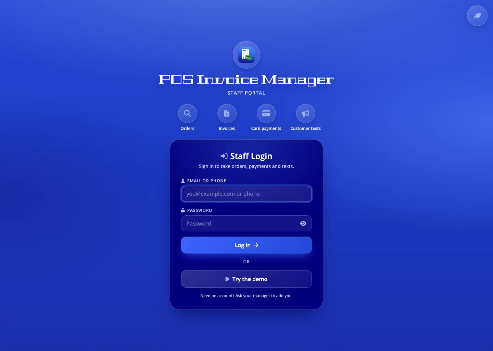
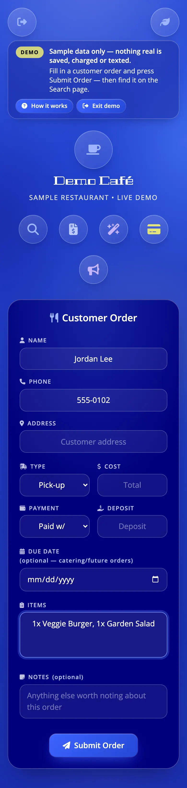
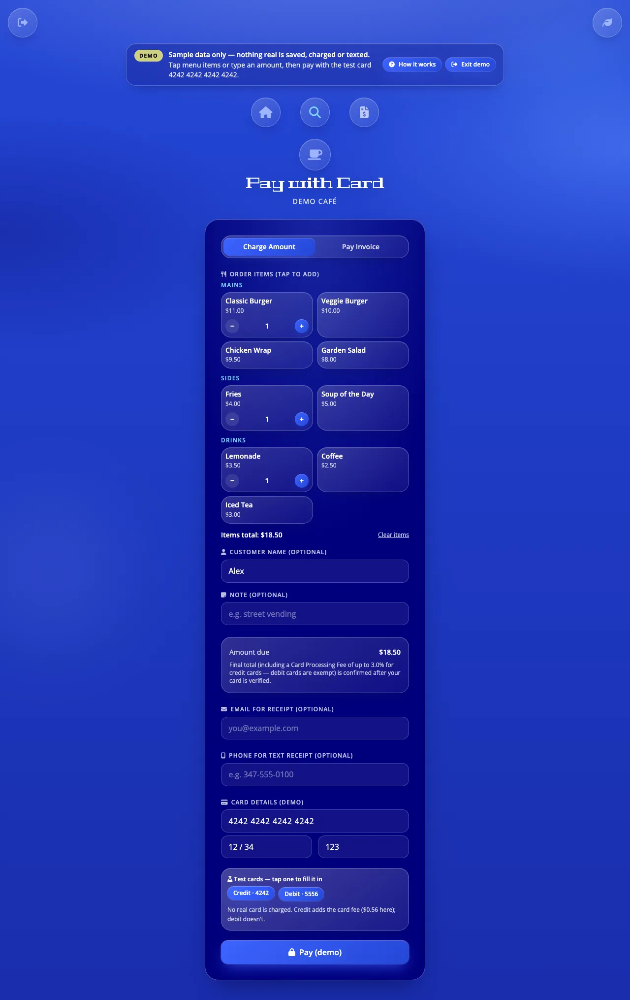
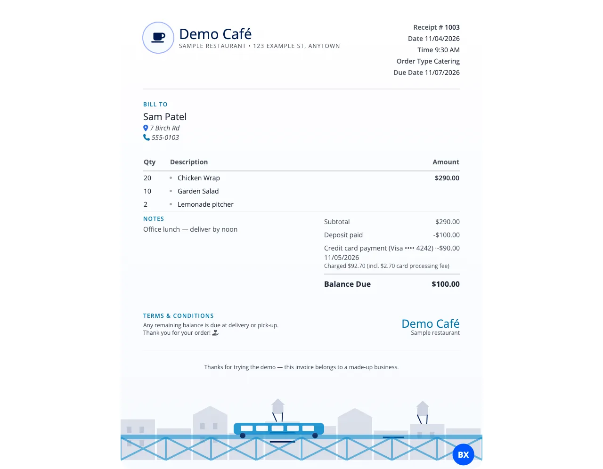
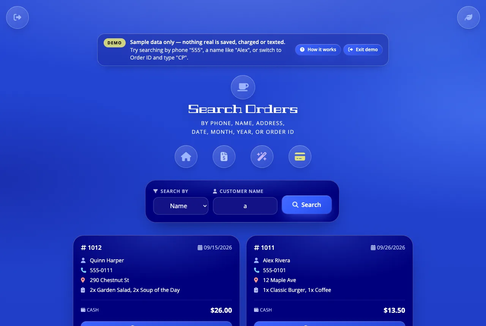
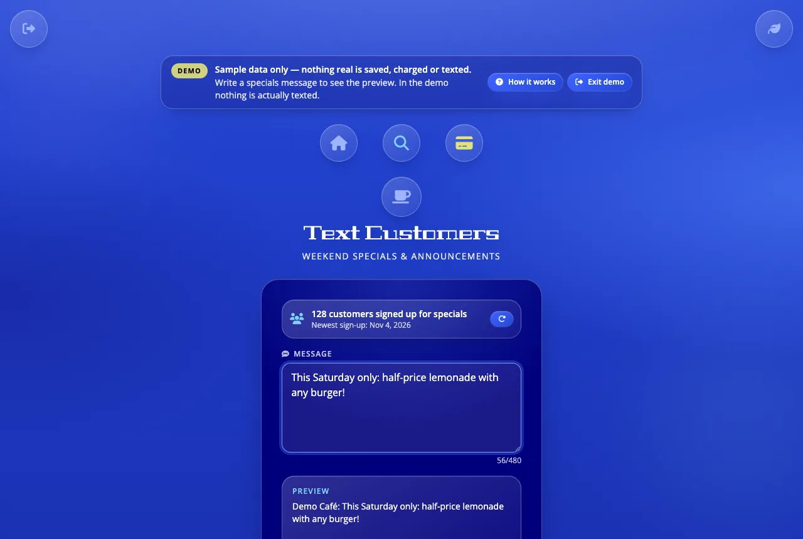

# Staff Guide: POS Invoice Manager

A quick guide for the people who take orders and payments every day.
Open the app at **https://pos-invoice-manager.vercel.app** on the tablet, phone or computer.

> The pictures below come from the app's **demo mode**, which uses a made-up café. Your screens show the real menu and orders.

---

## 1. Log in

Type your **email or phone number** and your **password**, then press **Login**.

- You stay logged in for 7 days on that device.
- If you see **"Your session expired. Please log in again."**, just log in. An order you were typing is still there.
- Forgot your password or need an account? Ask the manager. There is no sign-up button for staff.
- **Demo** opens a practice copy with fake orders. Nothing in the demo is saved, charged or texted.

## 2. Take an order

The home page is the order form.

1. Fill in **Name, Phone, Address, Type** (Delivery / Pick-up / Catering), **Cost, Payment** (Cash / Zelle) and **Deposit** (type `0` if none).
2. Write the **Items**, one per line or separated by commas. Write `2x` in front for quantities, e.g. `2x Taco de Chivo`.
3. **Due Date** and **Notes** are optional (use Due Date for catering).
4. Press **Submit Order** once. The button says **Saving…** while it works, and you'll see **Successfully Stored** when it's saved.

If the order **didn't save**, you'll see **"Order not saved"** and the form stays filled in. Check the internet and press Submit Order again.

## 3. Take a card payment

Tap the **card** button to open **Pay with Card**.

- **Charge Amount** is for walk-up sales. Tap menu items (or type an amount), add the customer's name if you like, then enter the card.
- **Pay Invoice** is for an existing order. Type the receipt number. Deposits and earlier card payments are already taken off.
- **Credit cards** add a card fee of up to 3%, and **debit cards** never do. The final total shows after the card is checked.
- Press **Pay** once and wait. The button is locked while the payment runs, so a customer can't be charged twice.
- When it's done you can **Text receipt** or open the receipt. **Charge another** clears everything for the next customer.

If you see **"Paid, but not added to the sheet"**, the customer *was* charged. Write down the Order ID shown and tell the manager.

## 4. Print or share an invoice

From a search result, press **Generate Invoice**. Then you can:

- **Print**: it always fits on one page.
- **Save as Image**: downloads a picture you can send.
- **Share**: copies a **read-only link** for the customer. They can see only that one invoice and can't change it.

To open a different invoice, tap the 🔍 next to **Receipt #** and type the number.

## 5. Find an old order

Tap the **magnifying glass**. Choose **Search by** (Phone, Name, Address, Date, Month, Year, or Order ID for card payments), type, and press **Search**.

## 6. Text customers

Tap the **megaphone**. Type the message, then press **Text Specials Subscribers**.

- The page shows **how many customers are signed up** and the date of the **newest sign-up**. Press ↻ to refresh it.
- The owner can also get an **email for every new sign-up** if that's been switched on.

- Only customers who signed up for texts on the website get it. Anyone who replied STOP is skipped automatically.
- Every text starts with the restaurant's name and ends with "Reply STOP to unsubscribe."
- You'll be asked to confirm the number of customers first. **A text can't be unsent.**
- To take someone off the list by hand, write `Yes` in the **Unsubscribed** column of the **SMSSignups** tab in the sheet.

## 7. If something goes wrong

| You see | What to do |
|---|---|
| "Couldn't reach the server…" | Check Wi-Fi or mobile data, then try again. Your typing is kept. |
| "Your session expired. Please log in again." | Log in. Your unsaved order comes back. |
| "Order not saved" | Press Submit Order again. Don't retype it, because it's still there. |
| "Payment failed" plus a card message (e.g. declined) | Ask for another card. **No charge was made.** |
| "Paid, but not added to the sheet" | The charge went through. Note the Order ID and tell the manager. |
| "Something went wrong" with a **Reload** button | Press Reload. A half-typed order is saved. |
| Anything else, or it keeps happening | Write down what you were doing and the message, and tell the manager. |
